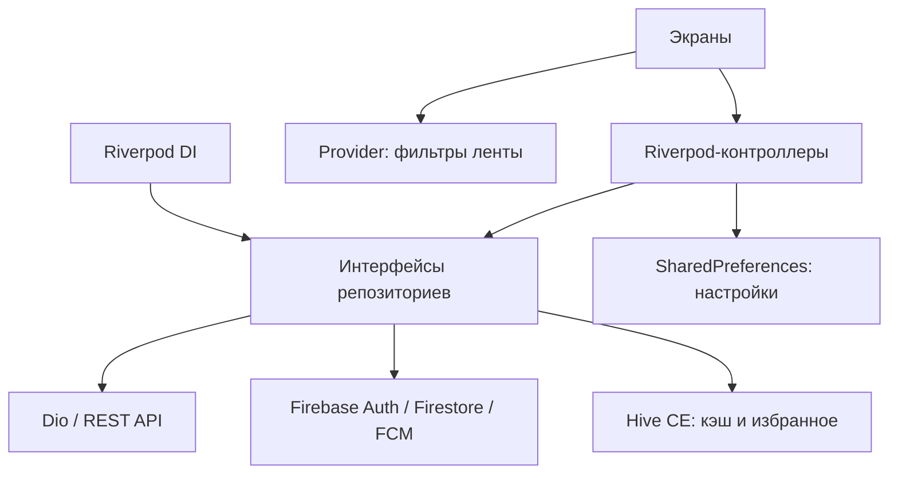

# Campus Assistant

Campus Assistant — учебное приложение для студентов на Flutter. Здесь можно посмотреть расписание своей группы, найти аудиторию, прочитать новости и записать интересующие события в избранное. Проект выполнен по теме №2 курса Flutter.

На главной показаны следующая пара, занятия на сегодня и личные задачи. Из страницы пары можно открыть нужную аудиторию на плане кампуса, перейти к дисциплине или посмотреть контакты преподавателя. Компактная карта разворачивается по кнопке: там можно приближать и перемещать план и выбирать корпуса.

Расписание, новости, события, адреса и контакты пока демонстрационные. Интеграции с информационной системой университета нет. Эти данные явно отмечены в приложении.

## Что есть в приложении

- **Главная:** следующая пара, занятия на сегодня, личные задачи, короткие превью новостей и событий.
- **Расписание:** выбор группы, дня и недели, время и место занятия, отметка текущей пары, личные задачи выбранной даты.
- **Лента:** новости и события с обложками, поиск с задержкой 300 мс, фильтры и избранное. Кнопка «Поделиться» копирует заголовок и ссылку.
- **Карта:** компактная схема с разворачиванием, список аудиторий, фильтр свободных по расписанию, этаж, вместимость и оснащение. Сведения о корпусе и аудитории открываются по нажатию. «Маршрут» открывает внешнюю карту по адресу корпуса.
- **Личные задачи:** создание, редактирование, дата, заметки, выполнение и удаление. Сохраняются на устройстве отдельно для каждого аккаунта.
- **Профиль:** настройки темы и языка, выбранная группа, выход из аккаунта.
- **Подробные страницы:** занятие, дисциплина и преподаватель со ссылками друг на друга. У дисциплины есть программа, материалы и расписание; у преподавателя — контакты, кабинет и список предметов.

Предусмотрены светлая и тёмная темы, русский и английский интерфейс. На планшетах нижнюю навигацию заменяет боковая панель. Контент демонстрационного набора остаётся на русском при любом языке интерфейса.

## Запуск в Chrome

Команды выполняются из папки `campus_assistant`. Нужны Flutter, Chrome и Dart, совместимый с ограничением `^3.13.5` в pubspec.yaml.

```powershell
flutter pub get
flutter run -d chrome --dart-define-from-file=firebase-web-config.json
```

`firebase-web-config.json` — локальный файл конфигурации Firebase Web. Он передаётся при запуске и не читается приложением автоматически. Без флага `--dart-define-from-file` появится сообщение «Firebase не настроен», даже если файл лежит в проекте.

Если файла нет, скопируйте [пример конфигурации](firebase-web-config.example.json) и заполните его значениями своего проекта:

```powershell
Copy-Item firebase-web-config.example.json firebase-web-config.json
```

Для Web нужны поля `FIREBASE_API_KEY`, `FIREBASE_APP_ID`, `FIREBASE_PROJECT_ID`, `FIREBASE_SENDER_ID` и `FIREBASE_AUTH_DOMAIN`. Значения берутся из настроек вашего Web-приложения в Firebase Console. Android appId для этого запуска не подходит. В Firebase Authentication включите Email/Password и Google, добавьте `localhost` и домен публикации в Authorized domains. Реальные конфигурации Firebase, файлы окружения, служебные учётные данные и ключи подписи исключены из Git; пример содержит только заглушки.

Для Android используйте локальный `android/app/google-services.json` и параметры `firebase-config.json`; файл параметров можно подготовить скриптом `tooling/firebase-config.ps1`. Android applicationId остаётся `com.example.campus_assistant`. Правила Firestore находятся в `firestore.rules`; применяйте их в своём проекте после проверки. Service-account JSON и закрытые ключи не нужны клиентскому приложению и не должны публиковаться.

При восстановлении пароля проверяйте также папку «Спам»: письмо Firebase может находиться там. Для реального проекта отдельно проверяйте вход, правила доступа, Google Sign-In и push на целевой платформе.

После изменения конфигурации остановите приложение и запустите его заново. Hot reload новые параметры сборки не подхватит. В работающем терминале `r` обновляет код, `R` перезапускает приложение, `q` завершает запуск.

Для открытия основных экранов нужен вход. Гостевой кнопки в текущем интерфейсе нет; демо-сессия используется в тестах. Firebase обеспечивает авторизацию, а данные кампуса по умолчанию берутся из локального набора — запускать Python-сервер для обычного просмотра не обязательно.

## Запуск с локальным API

Сервер написан на стандартной библиотеке Python и отдаёт тот же демонстрационный набор, что используется внутри приложения.

В первом терминале:

```powershell
python backend/server.py --host 127.0.0.1 --port 8085
```

Во втором:

```powershell
flutter run -d chrome --dart-define-from-file=firebase-web-config.json --dart-define=CAMPUS_API_URL=http://127.0.0.1:8085
```

Сервер предоставляет `/schedule`, `/news`, `/events`, `/subjects`, `/teachers`, `/buildings` и `/health`. Демонстрационные данные находятся в [backend/campus_demo.json](backend/campus_demo.json), реализация маршрутов — в [backend/server.py](backend/server.py).

## Устройство проекта

```text
lib/
  core/       настройки, контроллеры, репозитории, DI, маршруты и тема
  features/   экраны и доменные сущности отдельных разделов
  shared/     общие виджеты, CampusImage и компоненты дизайн-системы
  learning/   учебные примеры управления состоянием и витрина компонентов
  l10n/       локализация ru/en
backend/      демонстрационный REST API и его тесты
assets/       шрифты и изображения
test/        тесты приложения
tooling/     генераторы данных и проверки Firebase Rules
docs/sketches/ эскизы экранов
```

Основное состояние хранится в Riverpod: данные кампуса, авторизация, настройки и избранное. Репозитории подставляются через провайдеры; в тестах вместо Firebase и внешних приложений используются fake-реализации. Provider оставлен для локального состояния ленты: вкладки, категории и поискового запроса.



Модели сериализуются через json_serializable. Сгенерированные `.g.dart` находятся рядом с исходниками. Dio преобразует ошибки соединения, тайм-ауты, ответы сервера и ошибки разбора в отдельные типы исключений.

Для кэша, избранного и личных задач выбран Hive CE: в проекте достаточно хранения по ключу, без таблиц и SQL-запросов. SharedPreferences хранит тему, язык, группу и настройки уведомлений. Старые ключи кэша и избранного переносятся в Hive при запуске. Если приложение показывает сохранённые ответы API, рядом указана дата данных. Личные задачи не синхронизируются с облаком.

Firestore хранит профиль, выбранную группу и избранное пользователя. Локальные изменения применяются сразу; синхронизация повторяет неудачные записи и учитывает время обновления. Push-обработчики подключены для Android. Доставка уведомлений и Google Sign-In требуют отдельной проверки на устройстве.

### Управление состоянием

| Подход | Плюсы | Минусы | Где применять |
|---|---|---|---|
| setState | Мало кода, удобно для простого экрана | Состояние привязано к виджету | Небольшое локальное состояние |
| InheritedWidget | Передаёт данные потомкам без дополнительного пакета | Владение состоянием и обновления нужно организовать вручную | Общие данные внутри поддерева |
| Provider | Удобно наблюдать ChangeNotifier | Асинхронные состояния требуют дополнительного кода | Вкладки, фильтры и другие элементы одного экрана |
| Riverpod | Подмена зависимостей в тестах, работа с асинхронными данными | Нужно разобраться в провайдерах и их жизненном цикле | Данные и настройки, общие для нескольких экранов |

Riverpod выбран потому, что расписание, профиль и избранное используются в разных разделах, а источники данных нужно заменять в тестах. Три варианта одного примера «избранное» доступны через «Профиль → Информация → Неделя 3: состояние».

## Проверки

```powershell
dart format .
flutter analyze
flutter test
python -m unittest discover -s backend -p "test_*.py"
```

Обычный `flutter test` пропускает тест реального HTTP API, если сервер не указан. Чтобы выполнить его, сначала запустите backend, затем:

```powershell
flutter test --dart-define=CAMPUS_TEST_API=http://127.0.0.1:8085
```

После изменения моделей или ARB-файлов:

```powershell
dart run build_runner build
flutter gen-l10n
```

Последний полный прогон Flutter: **132 теста без пропусков**, анализатор без замечаний. Проверены связанные страницы, поиск и занятость аудиторий, разворачиваемая карта, именованные маршруты, формы, избранное, локализация, личные задачи и контраст цветов. Главная и расписание проверялись в обеих темах при ширине 320/360/667/1280 px и масштабе текста 1.6, включая редактор задачи с открытой клавиатурой.

Ручная проверка на устройстве не заменяется этими тестами. Открытие почтового клиента и внешней карты проверено через fake-адаптер, фактическое поведение зависит от установленных приложений.

## Статус по неделям

| Неделя | Реализовано | Автоматические проверки | Ручная проверка |
|---|---|---|---|
| 1–2 | Описание проекта, эскизы экранов, интерфейс и дизайн-система | Компоненты, размеры экранов, большой текст, контраст | Визуальная оценка |
| 3 | Демо setState / InheritedWidget / Provider; Riverpod в приложении | Добавление и удаление избранного в каждом демо, фильтры ленты | Объяснение выбранного подхода на защите |
| 4 | Репозитории пользователей и уведомлений, Riverpod DI | Подмена зависимостей, fake-репозитории | Работа профиля с реальным Firebase |
| 5 | REST API, json_serializable, типизированные ошибки сети | Полный, неполный и неверный JSON; ошибки HTTP | Подключение настоящего университетского API пока не предусмотрено |
| 6 | Hive CE, миграция старых ключей, дата кэша, ru/en | Хранилище, миграция, избранное, язык | Офлайн-режим на устройстве |
| 7 | Именованные маршруты, связанные страницы, 404 | Параметры и переходы, неизвестные id, поиск аудитории | Deep links на целевой платформе |
| 8 | Firebase Auth, профиль/группа/избранное в Firestore, FCM | Fake-формы и репозитории, синхронизация, тесты правил и push-маршрутов | Google Sign-In и доставка push |

## Ограничения

План кампуса нарисован внутри Flutter. GPS, Google Maps SDK и расчёт маршрута между аудиториями не подключены. Расписание повторяется по недельному шаблону; переключение недели меняет даты. Изображения — авторские демонстрационные иллюстрации. Email преподавателей и адреса корпусов относятся к учебному набору.

Для реального Firebase-проекта нужно проверить правила Firestore, разрешённые домены авторизации и ограничения API-ключа. Значения конфигурации не приводятся в README. Порядок локальной настройки приведён выше.

## Документация

- [Демонстрационные данные API](backend/campus_demo.json)
- [Пример конфигурации Firebase Web](firebase-web-config.example.json)
- [Эскизы экранов](docs/sketches/README.md)
- [Реестр изображений](assets/images/manifest.json), [авторство](CREDITS.md)
- [Дизайн-система и токены](lib/core/theme/campus_tokens.dart)

При выборе функций рассматривались [TUM Campus App](https://github.com/TUM-Dev/campus_flutter), [Atılım Schedule](https://www.atilim.edu.tr/atilim-schedule_base/header_en.php) и [приложение Nazareth University](https://naz.teamdynamix.com/TDClient/2774/Portal/KB/ArticleDet?ID=151350): поиск аудиторий, расписание, новости и события. Код этих проектов не использовался.
